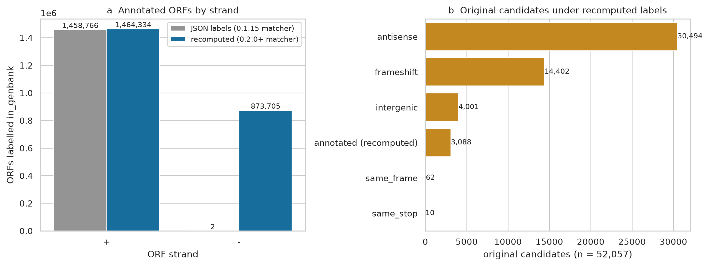
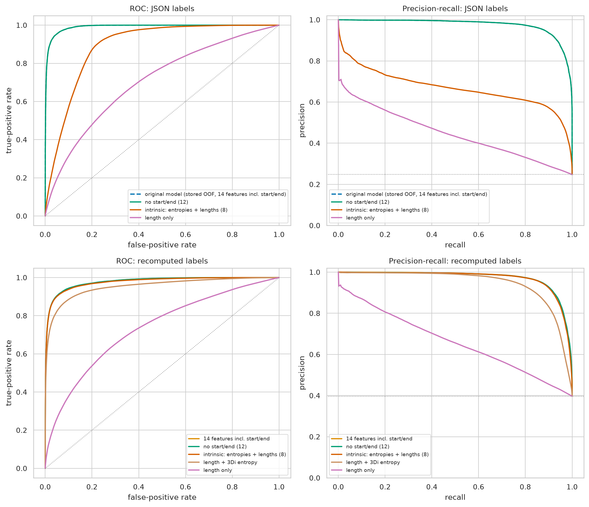
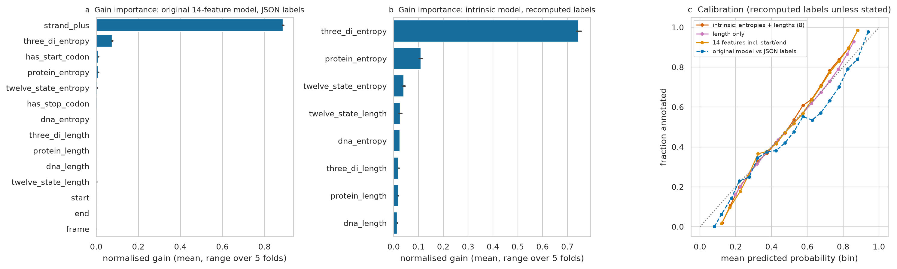
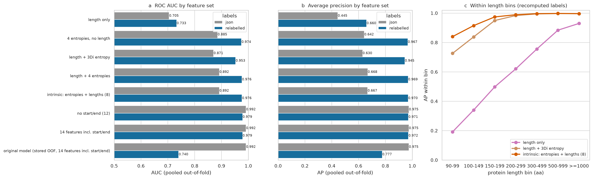
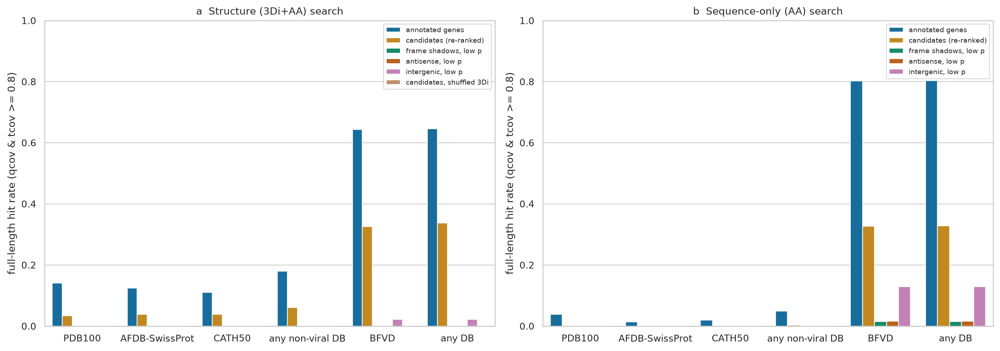
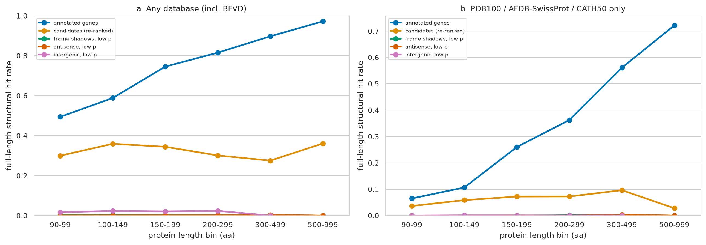
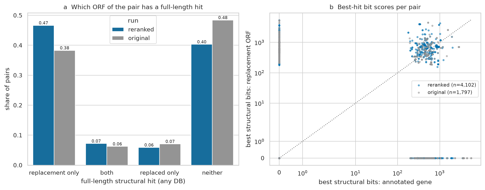

# Inphared phage ORF ranking: provenance, a label bug, coordinate-free re-ranking and Foldseek validation

Analysis report for the phage ORF-ranking sub-project (`scripts/rank_missing_orfs.py`). Written 2026-10-14 on Setonix. It is not the paper. All numbers come from the tables in `tables/` and the job logs listed under §8.

## Summary

1. **The original ranking was trained on broken labels.** The 312 input JSONs were made on 2026-07-28 with the matcher used before commit `2cc0e1a` (2026-07-31, released in 0.2.0). That matcher never matched a minus-strand ORF to its CDS:
   - JSON labels mark **2 of 2,885,504 minus-strand ORFs** as `in_genbank`.
   - Re-running the current matcher marks **873,705** of them, and 2,338,039 ORFs overall instead of 1,458,768.
   - The original model learned "plus strand ⇒ gene": `strand_plus` carries 89% of its gain.
   - Every one of the **52,057 original candidates is on the plus strand**.
   - Under the corrected labels its out-of-fold AUC falls from 0.992 to **0.740**.
   - The original numbers are reported below as **legacy-label** results.
2. **The absolute coordinates were not the problem.**
   - Dropping `start`/`end` changes nothing under either label set (AUC 0.9916 → 0.9916; 0.9785 → 0.9785), and their gain importance is ≈0.
   - The real shortcut was `strand_plus` under the buggy labels.
   - The re-ranking uses an **intrinsic** feature set: DNA, protein, 3Di and 12-state entropies and lengths, with no position, strand, frame or codon flags.
3. **Beyond length, corrected labels.**

   | model | AUC | AP |
   |---|---|---|
   | length only | 0.733 | 0.660 |
   | length + 3Di entropy | 0.953 | 0.945 |
   | intrinsic | **0.976** | **0.970** |

   - ΔAP over length is **+0.31**, the same size as LOGAN's +0.30 (but at a much higher prevalence, see §4.3).
   - Within the 100–149 aa bin AP goes from 0.34 to 0.91.
4. **Re-ranked candidates.**
   - **46,132** unannotated ORFs have p ≥ 0.8 (48.9% on the plus strand).
   - **4,102** overlapping-replacement candidates.
   - Only 18,942 of the 46,132 were original candidates.
5. **Foldseek** (20,000 length-matched ORFs per arm; full-length = qcov and tcov ≥ 0.8; structure = 3Di+AA):

   | arm | any of 4 DBs | without BFVD (PDB100/AFDB-SwissProt/CATH50) |
   |---|---|---|
   | annotated genes | 64.6% | 18.0% |
   | **candidates** | **33.8%** | **6.1%** |
   | intergenic, low p | 2.2% | 0.09% |
   | frame shadows, low p | 0.24% | 0.03% |
   | antisense, low p | 0.10% | 0.03% |
   | candidates, shuffled 3Di | 0.015% | 0% |

   - Scaled between controls and annotated genes, about **50%** (any DB) or **34%** (non-viral DBs only) of candidates behave like annotated genes.
   - Most BFVD hits are near-identical (≥90% identity) to UniProt entries that come from other phage annotations, so the non-viral-DB figure is the more independent estimate (§5.2).
6. **Replacement candidates.**
   - Re-ranked: in 47% of the 4,102 pairs only the replacement ORF has a full-length structural hit; in 6% only the annotated gene it would replace does.
   - Original 1,797 pairs: 38% vs 7%.

---

## 1. Objective

The ranking script uses out-of-fold coding probabilities from cross-validation grouped by genome. It looks for two kinds of ORF:

- **(a) Missed genes:** unannotated ORFs that look like real genes.
- **(b) Replacements:** annotated genes that a higher-scoring overlapping ORF should replace.

This report does five things:

1. records the provenance of the August 2026 run;
2. measures its performance;
3. removes coordinate features and quantifies the gain over length;
4. tests the candidates against external structural evidence, as was done for GTDB (`Validation/gtdb`, §6.1) and LOGAN (`Validation/logan`, scripts 21–25);
5. briefly assesses the replacement candidates.

## 2. Provenance (original run, job 46481896, 2026-08-17)

| item | value | how established |
|---|---|---|
| inputs | `genome_entropy:General/Validation/Inphared/genbank_split_json/phold_NNN.json`, **312 files** (13.2 GB) | the `.out` log lists each file read; remote listing |
| missing parts | 49 of 361 `genbank_split/phold_NNN.gbk` parts have no JSON: **every 5th part from 121 to 361** (121, 126, …, 361) | listing diff (`work/phage_rank/missing_parts.txt`). The regular pattern points to one failed worker or node, not to biology; untested. |
| genomes | 31,200 records (100 per part), 2.016 Gbp, median 47.1 kb (1.8–735 kb) | `tables/orfs.parquet` |
| annotation (label source) | Inphared 7 Apr 2026 genomes annotated with Pharokka + phold (`Pharokka/7Apr2026_genomes_pharokka_phold_out`). All 2,906,280 CDS carry `inference="ab initio prediction:Pyrodigal-gv:0.3.2"`, so **the positives are Pyrodigal-gv calls** with phold/PHROG functions. 12,753 CDS use table 15 and 1,686 table 4 (94 genomes). No compound CDS. Pharokka/phold versions are not recorded in the GenBank. | `cds.parquet` |
| 3Di model | `gbouras13/modernprost-50M` for all 5,887,690 ORFs, `--encoding-size 20000`, multi-GPU | per-feature `model_name`; part logs |
| ORF floor | `--min-aa 30`, but the **shortest ORF is 90 aa** (issue #103: `-l` is passed as aa×3). **28.8% of the annotated CDS (<90 aa) can never be represented.** | `orfs.parquet` |
| package version | runs on 2026-07-28 ~21:00 AWST, i.e. **v0.1.15** (tagged 2026-07-28). That version has the pre-`2cc0e1a` CDS matcher; JSON schema 2.1.0. | tags, log times, the label audit in §3 |
| ranking code | `scripts/rank_missing_orfs.py` at `5201235` (2026-08-17): raw get_orfs coordinates for overlaps, which `ea00cd6` later fixed. `--device cpu` in the wrapper, though the log shows the GPU fall-back warning. xgboost 3.4.1. | git history; `candidate_summary.json` lacks the newer keys |
| model | `XGBRFClassifier` (500 trees, depth 8, subsample and colsample_bynode 0.8, seed 42+fold) with `GroupKFold(5)` on `input_id`; 14 features incl. `start`, `end`, `strand_plus`, `frame`, `has_start_codon` (M anywhere), `has_stop_codon` (* anywhere) | script |

**Reproduction check.** The ORF order and labels of the original `all_orf_oof_predictions.parquet` are identical to the table rebuilt here, and the `GroupKFold` folds are identical. Refitting the 14-feature model reproduces the stored OOF probabilities:

- mean |Δp| = 0.0008;
- Jaccard of the p ≥ 0.8 candidate sets = 0.971;
- pooled AUC/AP identical to 4 d.p.

xgboost was 3.4.2 here, against 3.4.1 originally.

## 3. The label bug (legacy labels)

The JSON `in_genbank` flag came from the matcher used before 2026-07-31. It compared "biological stop coordinates" without mapping minus-strand get_orfs coordinates, which index the reverse complement, back to the genomic axis. `02_relabel.py` recomputes the flag for every ORF. It calls the current matcher (`extract_cds_features` + `match_orf_to_genbank_cds` from this checkout: same strand and phase, ≥90% overlap of the shorter interval, ≥98% identity over shared codons) exactly as the pipeline does.

| strand | JSON `in_genbank` | recomputed `in_genbank` | ORFs |
|---|---|---|---|
| + | False | False | 1,534,698 |
| + | False | **True** | 8,722 |
| + | True | False | 3,154 |
| + | True | True | 1,455,612 |
| − | False | False | 2,011,799 |
| − | False | **True** | **873,703** |
| − | True | True | 2 |

**Corrected totals.** 2,338,039 annotated ORFs (39.7%), against 1,458,768 (24.8%) in the JSON.

**Cross-check.** The phage-MI work recomputed labels independently for the 6.75 M-ORF `phold.gbk` set (`work/phage_mi/phage_orf_labels_v2.parquet`, branch `validation/phage-mutual-information`). It agrees on 5,887,451 of 5,887,690 ORFs. The 239 that differ are positive there and negative here; the cause was not investigated (possibly the protein string used).

*Figure 1.* (a) ORFs labelled `in_genbank` by strand, JSON vs recomputed. (b) The 52,057 original candidates classified with the corrected labels and their genomic context:

- 3,088 (5.9%) are annotated genes;
- 30,494 are antisense to a CDS;
- 14,402 sit in another frame of a same-strand CDS;
- 4,001 are intergenic.

Because the bug removed every minus-strand positive, the original classifier learned the strand. Table 1 shows the size of the effect.

## 4. Model performance

All models below use the same estimator, the same seeds and the same folds as the original. Only the feature set and the labels change (`03_models.py`). AUC is ROC AUC; AP is average precision (`tables/model_metrics*.tsv`). Fold-to-fold SD is ≤0.001 for every model scored against the labels it was trained on (the stored original model scored against corrected labels varies from 0.72 to 0.81 AUC across folds); per-fold values are in `model_metrics.tsv`.

### 4.1 Pooled out-of-fold metrics

Table 1: AUC and AP under each label set.

| feature set | features | AUC, JSON labels | AP, JSON labels | AUC, corrected | AP, corrected | p ≥ 0.8 unannotated (corrected) |
|---|---|---|---|---|---|---|
| original model (stored OOF) | 14 | **0.9916** | **0.9751** | **0.7404** | **0.7765** | — |
| 14 features, refit | 14 | 0.9916 | 0.9750 | 0.9785 | 0.9718 | 44,371 |
| no start/end | 12 | 0.9916 | 0.9752 | 0.9785 | 0.9713 | 44,851 |
| **intrinsic** (entropies + lengths) | 8 | 0.8920 | 0.6673 | **0.9764** | **0.9696** | 46,141 |
| length + 4 entropies | 5 | 0.8921 | 0.6681 | 0.9762 | 0.9693 | 47,468 |
| 4 entropies, no length | 4 | 0.8854 | 0.6423 | 0.9745 | 0.9669 | 51,460 |
| length + 3Di entropy | 2 | 0.8705 | 0.6300 | 0.9527 | 0.9449 | 57,708 |
| length only | 1 | 0.7048 | 0.4448 | 0.7328 | 0.6598 | 32,060 |

How to read Table 1:

- **Legacy labels.** The original 52,057 candidates come from the first row. At the same threshold the refit and no-start/end models give 51,781 and 51,347.
- **Prevalence.** It is 0.248 under the JSON labels and 0.397 under the corrected ones.
- **The 0.8 threshold.** The random-forest probabilities span about 0.11–0.89 (`score_by_class.tsv`), so p ≥ 0.8 is near the top of the scale, not a calibrated 80%.
- **Precision-based thresholds.** On the corrected labels the intrinsic model reaches precision 0.90 at p = 0.348 (recall 0.917) and 0.95 at p = 0.604 (recall 0.867); see `model_thresholds.tsv`. Precision against these positive–unlabelled labels is a lower bound.
- **What the strand shortcut cost.**
  - The legacy model's strand reliance is a bug artefact. On corrected labels the stored original probabilities score AUC 0.740.
  - With the JSON labels, the intrinsic model (no strand) reaches only 0.892 / 0.667: it is penalised for every real minus-strand gene it scores highly.
- **Coordinates.** Removing `start`/`end` costs nothing under either label set (Δ ≤ 0.0005), and their mean gain is <0.001.
- **Frame, strand and the M/* flags.** Under corrected labels these add only 0.002 AUC (14-feature 0.9785 vs intrinsic 0.9764). Most of that comes from `has_start_codon` (M anywhere, mean gain 0.11), which is a weak length/composition proxy. The intrinsic set is used for the re-ranking because every feature in it is a property of the ORF sequence.

*Figure 2.* ROC and PR curves.

- **Top row: JSON (legacy) labels.** The stored original model (dashed) lies under the refit no-start/end curve.
- **Bottom row: corrected labels.**

### 4.2 Feature importance and calibration

*Figure 3.* Mean normalised gain over the five folds, plus reliability curves.

| model | strand_plus | 3Di entropy | has_start_codon | protein entropy | start, end |
|---|---|---|---|---|---|
| original 14-feature, JSON labels | **0.888** | 0.075 | 0.010 | 0.010 | <0.001 |
| 14-feature refit, corrected labels | 0.010 | **0.672** | 0.114 | 0.080 | <0.001 |

Intrinsic model, corrected labels (gain):

| 3Di entropy | protein entropy | 12-state entropy | all lengths together |
|---|---|---|---|
| **0.745** | 0.109 | 0.041 | 0.08 |

**Calibration.** The corrected-label models are close to the diagonal (Brier 0.061 for intrinsic, 0.200 for length only). The original model is slightly over-confident above 0.5 against its own labels.

### 4.3 Beyond length

*Figure 4.* (a, b) Pooled AUC and AP by feature set, for both label sets. (c) AP within protein-length bins, corrected labels.

| length bin (aa) | prevalence | AP, length only | AP, length + 3Di | AP, intrinsic | AUC, intrinsic |
|---|---|---|---|---|---|
| 90–99 | 0.176 | 0.192 | 0.726 | **0.840** | 0.944 |
| 100–149 | 0.279 | 0.340 | 0.838 | **0.915** | 0.959 |
| 150–199 | 0.461 | 0.498 | 0.950 | **0.974** | 0.977 |
| 200–299 | 0.577 | 0.621 | 0.983 | **0.989** | 0.986 |
| 300–499 | 0.720 | 0.756 | 0.995 | **0.996** | 0.992 |
| 500–999 | 0.856 | 0.884 | 0.997 | **0.998** | 0.992 |
| ≥1000 | 0.917 | 0.930 | 0.996 | **0.996** | 0.976 |

**Overall gain.** On corrected labels, entropies add **+0.31 AP** (0.660 → 0.970) and **+0.24 AUC** over length alone. 3Di entropy on its own supplies most of it (+0.29 AP). The 4-entropy model without length reaches AUC 0.975.

**Comparison with LOGAN.** LOGAN's grouped-CV models gained ΔAP ≈ +0.30 (0.58 → 0.88) at a positive rate of ~2.4%, against Prodigal-meta labels. Here the gain is similar, but prevalence is 40%: the phage genomes are dense and only ORFs ≥90 aa exist. The two AP gains are therefore not directly comparable.

**Within length bins.** Here the comparison is cleaner, and in each bin the phage and LOGAN numbers are of the same order:

| length bin (aa) | phage AP (length → intrinsic) | LOGAN AP (length → all features) |
|---|---|---|
| 100–149 | 0.34 → 0.92 | 0.13 → 0.77 |

## 5. External validation of the re-ranked candidates

### 5.1 Design (`05_select_queries.py`, `06_foldseek_search.slurm`, `07_evidence.py`)

**Re-ranking.** `scripts/rank_missing_orfs.py --feature-set intrinsic` was run on the relabelled JSONs (job 50802406).

| quantity | count |
|---|---|
| ORFs | 5,887,690 |
| annotated | 2,338,039 |
| candidates (unannotated, p ≥ 0.8, ≥30 aa) | **46,132**, in 19,560 genomes; median 136 aa |
| replacement candidates | **4,102** |
| ORFs excluded from the overlap search (minus-strand contig-edge ORFs with the `end = L+1` sentinel) | 7,628 |

**Candidate context** (from `01_build_orf_table.py`, relative to the GenBank CDS):

| context | candidates |
|---|---|
| antisense to a CDS | 22,913 |
| same-strand, other frame | 15,005 |
| intergenic | 4,169 |
| share a stop with a CDS | 3,083 |
| same frame, different stop | 962 |

The last two contexts (4,045 ORFs, 8.8%) are pieces of annotated genes that still fail the matcher. They are mostly partial CDS at genome ends: 2,897 of the 3,083 share-a-stop and 849 of the 962 same-frame ORFs belong to a CDS flagged `partial`, and 103 involve genetic-code-15/4 genomes. They are reported but not searched.

**Arms.** Twenty thousand ORFs each; the controls are nearest-length matched to the candidate arm without replacement (median 133 aa in every arm except intergenic_lo, 124 aa).

| arm | definition |
|---|---|
| candidate | random 20,000 of the 42,087 intergenic, antisense and frameshift candidates |
| annotated | annotated ORFs (positive control) |
| antisense_lo | antisense ORFs with p < 0.5 |
| frameshift_lo | same-strand other-frame ORFs with p < 0.5 |
| intergenic_lo | intergenic ORFs with p < 0.5 |
| shuffled null | the candidate arm with each 3Di string permuted |
| extra (all ORFs) | 4,102 replacement ORFs and the 4,039 genes they would replace; the original 1,797 pairs; 5,000 random original candidates |

**Search.** As in LOGAN (#92):

- query databases are built from AA plus ModernProst-50M 3Di strings (Validation/gtdb `15_build_query_db.py`, tsv2db);
- Foldseek 10.941cd33 runs on CPU;
- structure search is `search --alignment-type 2 --sort-by-structure-bits 0 -e 1e-3`;
- sequence search is `base:search -e 1e-3`.

**Databases** (shared with LOGAN; AFDB50 skipped):

| database | version |
|---|---|
| PDB100 | 2025-01-01 |
| AFDB-SwissProt | v6 2025_03 |
| CATH50 | v4.3.0 |
| BFVD | 2025_03_v3 |

**Full-length** means qcov and tcov both ≥ 0.8. The mixture share is (candidate − control) / (annotated − control).

### 5.2 Results

*Figure 5.* Full-length hit rates by arm and database: (a) structure search, (b) sequence-only search.

**Full-length structural hit rate (3Di+AA)** (`tables/evidence_rates.tsv`; 95% Wilson CIs there):

| arm | PDB100 | AFDB-SwissProt | CATH50 | BFVD | any non-viral | any DB | any hit, any DB (loose) |
|---|---|---|---|---|---|---|---|
| annotated | 14.1% | 12.4% | 11.0% | 64.4% | 18.0% | **64.6%** | 72.8% |
| **candidate** | 3.4% | 3.8% | 3.9% | 32.6% | **6.1%** | **33.8%** | 42.7% |
| intergenic_lo | 0.01% | 0.09% | 0.01% | 2.18% | 0.09% | 2.20% | 2.6% |
| frameshift_lo | 0% | 0.03% | 0% | 0.22% | 0.03% | 0.24% | 0.41% |
| antisense_lo | 0% | 0.02% | 0.01% | 0.07% | 0.03% | 0.10% | 0.34% |
| candidate, shuffled 3Di | 0% | 0% | 0% | 0.015% | 0% | **0.015%** | 0.025% |
| original candidates (n = 5,000) | — | — | — | — | 4.4% | 23.2% | 31.3% |

**Excess over controls and mixture share** (`evidence_excess.tsv`):

| databases | excess over the controls | mixture share of candidates that look like genes |
|---|---|---|
| any DB | +31.6 to +33.8 points | 50.6–52.3% |
| non-viral DBs | +6.1 points | **33.7–34.0%** |
| per database: PDB100, AFDB-SwissProt, CATH50, BFVD | — | 24%, 30%, 35%, 50% |

Applied to the 42,087 searchable candidates, the non-viral share gives roughly **14,000–22,000** genes that look like real genes (using the 34% and 50% shares). This is an extrapolation, not a count.

**Candidates by context** (`evidence_by_context.tsv`):

| context | full-length structural, any DB | non-viral | sequence-only |
|---|---|---|---|
| intergenic (n = 1,979) | 66.5% | 8.2% | 66.3% |
| frameshift (n = 7,084) | 61.6% | 10.3% | 61.3% |
| antisense (n = 10,937) | 9.9% | 3.1% | 8.2% |

- Antisense candidates still exceed their low-score antisense control (0.10% / 0.03%) by about 100-fold.
- They are, however, far weaker than the other contexts. Most look like the high-3Di "antisense shadows" GTDB described, with a minority of genuine overlapping or wrong-strand calls; see exemplars E6–E8.

**BFVD is mostly an annotation-concordance signal, not independent homology.** BFVD contains predicted structures of UniProt viral proteins, which are translations of INSDC phage annotations. The data show this directly (`evidence_identity.tsv`):

| arm | median identity of full-length BFVD structural hits | share ≥90% identity |
|---|---|---|
| annotated | 0.99 | 86% |
| candidates | 0.98 | 71% |
| intergenic_lo | 0.93 | 84% (2.2% of the arm) |

- BFVD **sequence** search alone recovers 80% of the annotated arm, and 12.9% of low-score intergenic ORFs. The latter are conserved non-coding stretches that some submitter annotation called as genes.
- A BFVD hit therefore mostly says that "another annotation of this or a related genome called this ORF a protein": concordance with a different gene caller.
- The non-viral databases are the independent remote-homology test. There, candidate full-length hits have median identity 0.16–0.18 (≥90% in <1%), and the candidate rate is 6.1% against 18.0% for annotated genes and ≤0.09% for every control.

**Inphared redundancy.** Inphared contains near-duplicate genomes, e.g. RefSeq `NC_` copies of GenBank records (NC_095800 / MF001358 share an identical candidate). This also means the genome-grouped CV is not homology-grouped, so the OOF metrics may be slightly optimistic.

*Figure 6.* Full-length structural hit rate by length: (a) any database, (b) non-viral databases only.

| length bin (aa) | candidates, any DB | candidates, non-viral | annotated, any DB | annotated, non-viral |
|---|---|---|---|---|
| 90–99 | 30.0% | 3.6% | 49.4% | 6.5% |
| 100–149 | 35.9% | 5.9% | 58.8% | 10.7% |
| 150–199 | 34.4% | 7.2% | 74.5% | 26.0% |
| 200–299 | 30.1% | 7.3% | 81.6% | 36.3% |
| 300–499 | 27.5% | 9.6% | 89.7% | 56.1% |

- Annotated genes gain hits with length.
- Candidates stay flat at about 30%, so the candidate/annotated ratio falls with length. Long unannotated ORFs that still score high are increasingly likely to be shadows of long genes.

**Evidence classes** (full-length; structure = 3Di+AA, sequence = AA only, any DB):

| arm | sequence + structure | structure only | sequence only | neither |
|---|---|---|---|---|
| annotated | 62.1% | 2.5% | 18.3% | 17.1% |
| candidate | 27.6% | **6.2%** | 5.2% | 61.0% |
| intergenic_lo | 2.2% | 0.03% | 10.8% | 87.0% |

**Taxonomy of best full-length hits.** 95.4% of candidate hits and 99.1% of annotated hits are viral (`hit_superkingdom.tsv`). Unlike LOGAN, there is no eukaryotic excess (2.7%).

### 5.3 Exemplars (`tables/exemplars.tsv`)

**Selection.** Highest-p candidates with full-length structural hits in ≥2 databases, at least one of them non-viral, deduplicated by target. Five from each context would be selected; the table holds five intergenic, three antisense and two frameshift. All have p ≈ 0.89 (the score ceiling) and 3Di entropy 3.35–3.71 bits.

| # | genome | ORF (aa) | context | best non-viral hit | BFVD hit | note |
|---|---|---|---|---|---|---|
| E1 | OP534061 | 131277–131741 (−), 154 | intergenic, between nucleotidyltransferase and transcriptional repressor | PDB 3h08 RNase H1 (E 1e-10, tcov 0.99); SwissProt RNase H | RNase H | the same intergenic RNase H in sibling genomes PP680567 and NC_095800/MF001358 |
| E2 | OR354839 | 48055–48534 (−), 159 | intergenic, next to an HNH endonuclease | PDB 4olk CHAP domain of LysGH15 | N-acetylmuramoyl-L-alanine amidase | a missed lysin/CHAP domain |
| E3 | MW584209 | 56917–57474 (−), 185 | intergenic, next to a radical-SAM protein | PDB 4j25 prolyl-4-hydroxylase; SwissProt EGLN3 | 2OG-Fe(II) oxygenase | **structure only**: no full-length sequence hit |
| E4 | FN667789 | 42567–43043 (+), 158 | intergenic, after the tail tube | — | head completion nuclease | BFVD only |
| E5 | NC_072501 | 13742–14236 (−), 164 | intergenic, between minor tail and head–tail adaptor | PDB 2gjv | tail terminator | fits the morphogenesis-module context |
| E6 | NC_027392 | 20396–21094 (−), 232 | antisense; overlaps a 252-bp + strand "hypothetical" | PDB 3b39 DnaG primase catalytic domain | DNA primase | next to a DnaB-like helicase; Pyrodigal-gv probably called the wrong strand |
| E7 | OM716000 | 8031–8723 (−), 230 | antisense to the 3′ end of DNA polymerase | CATH 3.40.50.300 (P-loop) | AAA+ ATPase | |
| E8 | MH445380 | 88848–89651 (+), 267 | antisense to a 274-aa "hypothetical" (−, 88812–89633) | SwissProt IS431mec transposase | IS26 transposase | the annotated gene is the antisense shadow of a transposase |
| E9 | PX677422.1 | 26529–27248 (+), 239 | other frame of a near-coextensive "hypothetical" CDS | SwissProt RsmA; CATH 1svu | C5-methyltransferase | |
| E10 | MW722521 | 32172–32927 (−), 251 | other frame; spans "hypothetical" + "DNA methyltransferase" CDS | SwissProt M.AquIA; PDB 8tdr | C5-methyltransferase | looks like a frameshifted or mis-split methyltransferase |

E6, E8 and E9 are cases where the ORF that scores and hits is not the one Pyrodigal-gv annotated over the same stretch. These are replacement-like, even though they are not in the replacement list, because the annotated competitor sits on the other strand or in the other frame and the overlap filter ranks by overlap length.

## 6. Replacement candidates

- **Re-ranked run:** 4,102 pairs.
  - 57% of replacement ORFs share the strand of the gene they would replace.
  - Median overlap is 70% of the shorter ORF.
- **Original run:** 1,797 pairs, all plus/plus.
  - Raw-coordinate overlaps were therefore correct for them; the minus-strand coordinate bug did not affect these pairs.
  - 1,775 of the 1,797 replaced ORFs are still annotated under corrected labels.

| run | pairs | only replacement has a full-length structural hit | both | only the replaced gene | neither | replacement has the higher best-hit bits |
|---|---|---|---|---|---|---|
| re-ranked | 4,102 | **1,913 (46.6%)** | 295 (7.2%) | 241 (5.9%) | 1,653 (40.3%) | 59.4% |
| original | 1,797 | 688 (38.3%) | 112 (6.2%) | 127 (7.1%) | 870 (48.4%) | 54.3% |

*Figure 7.* (a) Which ORF of each pair has a full-length structural hit. (b) Best-hit bit scores per pair.

**Full-length structural hit rates by arm:**

| arm | any DB | non-viral |
|---|---|---|
| replacement ORFs | 53.8% | 10.0% |
| genes they would replace | 13.2% | 0.37% |

**Sequence-only hits** reach 48.6% for the replaced genes, almost all against BFVD and near-identical. That is what one expects when the replaced gene is an annotation that other pipelines also made.

**Reading.** When the model prefers an overlapping ORF, that ORF usually carries the structural evidence. In about 1 in 2 pairs the current annotation is plausibly the wrong frame or strand. Each case needs manual checking before any re-annotation claim.

Re-ranked pair-level results are in `work/phage_rank/foldseek_intrinsic/replacement_pairs.tsv`.

## 7. Comparison with GTDB and LOGAN

| | GTDB r232 (bacteria) | LOGAN metagenomes | Inphared phages (this report) |
|---|---|---|---|
| labels | deposited CDS | Prodigal `-p meta` | Pharokka (Pyrodigal-gv 0.3.2) CDS, recomputed |
| candidate rule | unmatched, 3Di ≥ 2.5, not a shadow | intergenic, ≥100 aa, grouped-CV score ≥ t(precision 0.90) | unannotated, intrinsic-model OOF p ≥ 0.8 (shadows included, analysed separately) |
| candidates | 545,793 | 3.43 M | 46,132 |
| full-length structural hit rate (any DB): candidates / positive control | ~23–27% real share (mixture) | 19.3% / 56.1% | **33.8% / 64.6%** |
| without BFVD | Swiss-Prot 23.3%, PDB 23.4%, CATH 27.0% share | — | 6.1% / 18.0% (share 34%) |
| best null / control | shuffled 3Di ≤ 0.04% | antisense 0.13%, intergenic 0.03%, shuffled 0.005% | antisense_lo 0.10%, intergenic_lo 2.2%, shuffled 0.015% |
| structure-only share of candidates | 6/10 exemplars | 16.6% | 6.2% |
| ΔAP over length (grouped CV) | n/a | +0.30 | +0.31 |

**Where phage is like GTDB and LOGAN.**

- Shuffled-3Di nulls stay near zero.
- Low-score controls stay at or below 2%.
- A substantial minority of candidates gets full-length structural hits; mixture shares are about 1/3 to 1/2.

**Where phage differs.**

1. **BFVD dominates every arm.** For LOGAN it was mainly an artefact of the eukaryotic/viral composition; here the target organisms are themselves the source of BFVD.
2. **Annotated phage genes rarely hit non-viral structure databases** (18% vs 56% for LOGAN Prodigal genes). The absolute non-viral rates are therefore low for every arm.
3. **Shadows were not excluded.** Antisense candidates are about half of the searched candidates and validate poorly (3.1% non-viral). A GTDB-style "not a shadow" filter would raise the validated share.

## 8. Methods, jobs and files

**Environment.**

- Scripts and Slurm wrappers are in `Validation/Inphared/scripts/`. Every job sources `env.sh`.
- Conda env `/scratch/pawsey1018/edwa0468/software/envs/phage_rank`: python 3.12, xgboost 3.4.2, scikit-learn 1.9.1, pandas 3.0.6, numpy 2.5.4, seaborn 0.13.2, biopython 1.88.
- Foldseek env as in LOGAN.
- The package code (matcher, `normalise_orf_interval`, `rank_missing_orfs.py`) comes from this checkout.
- The old pip venv the August wrapper expected (`software/pip/genome_entropy`) no longer has a `bin/` directory, so it could not be reused.

**Jobs.** CPU `work` partition, account pawsey1018, ~430 SU in total.

| job | script | what | elapsed |
|---|---|---|---|
| 50802064 | `01_build_orf_table.slurm` | flatten 312 JSONs + GenBank → `orfs`/`seqs`/`cds.parquet` | 1 min |
| 50802300 | `02_relabel.slurm` | recompute `in_genbank`; write relabelled JSONs + `labels.parquet` | 4 min |
| 50802364 / 50802365 | `03_models.slurm json` / `relabelled` | 8 feature sets × 5 folds | 83 / 61 min |
| 50802406 | `04_rank.slurm intrinsic` | `rank_missing_orfs.py --feature-set intrinsic` on relabelled JSONs | 16 min |
| 50802818 | `05_select_queries.slurm` | arms + query DBs (`qdb` 116,726 entries, `qnull` 20,000) | 1 min |
| 50802819_[1-4] | `06_foldseek_search.slurm` | PDB100, AFDB-SwissProt, CATH50, BFVD | 5, 11, 3, 89 min |
| 50805038 and reruns | `07_evidence_figures.slurm` | evidence tables, figures | ~1 min each |

**Data on /scratch** (21-day purge; not in git): `/scratch/pawsey1018/edwa0468/genome_entropy/work/phage_rank/`.

- inputs: `genbank_split_json/`, `genbank_split/` (312 `.gbk.gz`);
- `genbank_split_json_relabelled/`;
- `tables/` (`orfs`, `seqs`, `cds`, `labels` parquet);
- `models_{json,relabelled}/` (OOF parquet etc.);
- `rank_orfs_relabelled_intrinsic/` (the re-ranked outputs, same layout as the original);
- `foldseek_intrinsic/` (selection, FASTAs, m8, per-query evidence);
- `rank_orfs_orig/` (a copy of the remote originals).

**Code change to `scripts/rank_missing_orfs.py`.**

- New `--feature-set {intrinsic,no-coordinates,all}`, default `intrinsic`; `all` reproduces the original behaviour.
- The overlap search skips unannotated ORFs below the replacement probability bound. The result is unchanged and this is tested.
- `slurm/rocm/rank_missing_orfs.slurm` takes the feature set as an optional third argument.
- `tests/test_rank_missing_orfs.py`: 8 tests pass. The full test suite was not run; it needs torch/model downloads.

## 9. Caveats and open questions

1. **Labels are Pyrodigal-gv calls, not truth.** Positive–unlabelled framing applies: candidates are "ORFs Pyrodigal-gv did not call", and precision against these labels underestimates true precision.
2. **Annotated genes below 90 aa are invisible** (#103): 28.8% of CDS. The phage ORF set should be regenerated with the #103 workaround (`-l 29` as in LOGAN) before any short-gene claim.
3. **Many candidates are shadows.** Antisense (50%) and other-frame (33%) candidates dominate. Their high 3Di entropy partly reflects a gene on the other strand or frame. Only about 10% of searched antisense candidates have any full-length hit.
4. **BFVD hits are largely near-identical annotation concordance** (§5.2). Use the non-viral rates for the independent-homology claim. Even those include phage proteins in SwissProt/PDB (e.g. 17 intergenic_lo ORFs hit SwissProt at ≥99% identity).
5. **Genome redundancy.** Inphared has near-identical genomes, including RefSeq/GenBank duplicates. GroupKFold groups by record, not by cluster, so OOF metrics can be optimistic and candidate counts include duplicates. A cluster-grouped CV (e.g. by ANI or vConTACT cluster) was not run.
6. **49 parts are missing** in a regular pattern (every 5th from 121). It is probably technical; the effect on composition was not checked.
7. **Implementation differences.**
   - The 7,628 minus-strand contig-edge sentinel ORFs are not placed by `rank_missing_orfs.py`, so they get no replacement analysis.
   - The 46,132 (rank script, float64) vs 46,141 (`03_models.py`, float32) candidate counts differ through numerical noise only.
8. **Scope of the replacement-pair test.** It only asks which ORF has the better external evidence. It does not establish that the annotation is wrong: overlapping genes do exist in phages.
9. **Phage MI analysis.** The coordinator confirmed that the same label bug affects the phage MI work; it has recomputed labels (`phage_orf_labels_v2.parquet`).
10. **Not done.**
    - AFDB50 (skipped by request).
    - A GTDB-style non-shadow candidate rule with exemplar dossiers.
    - A homology-grouped CV.
    - A check of whether BFVD hits are self-hits (the same Inphared genome) or sibling-genome hits.
