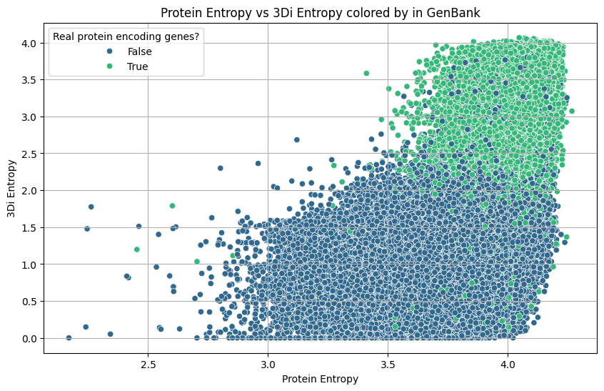
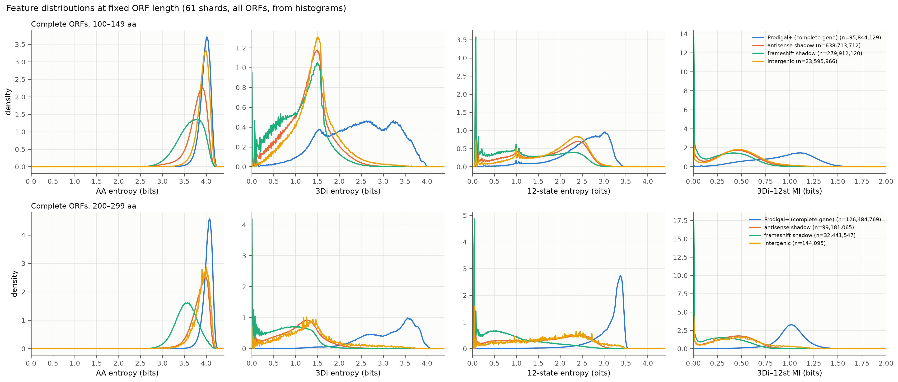
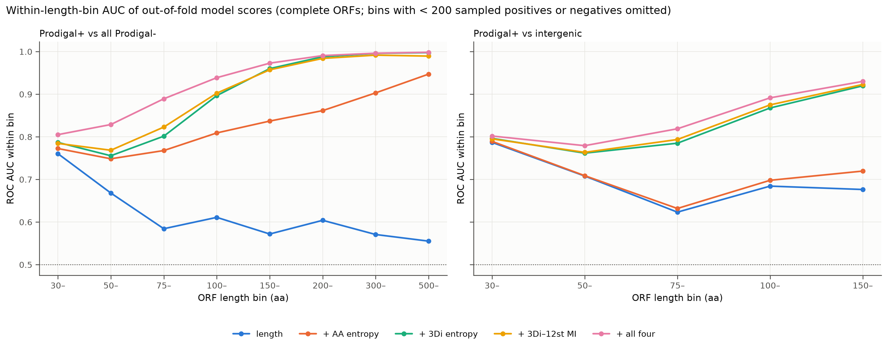
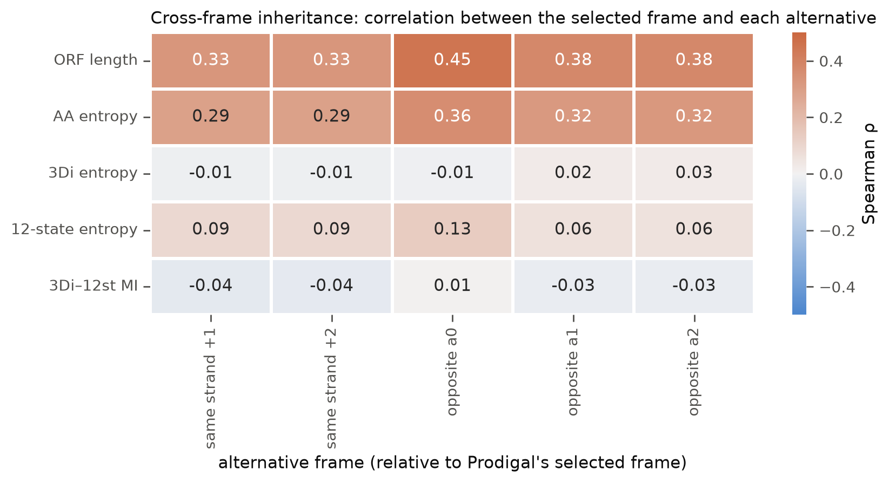
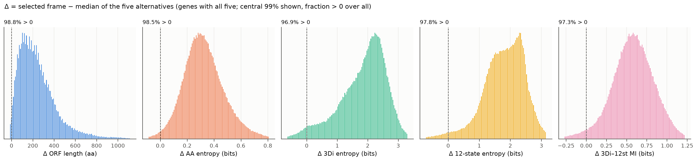
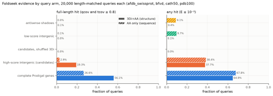
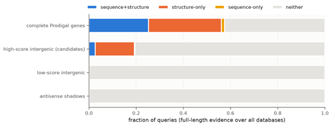
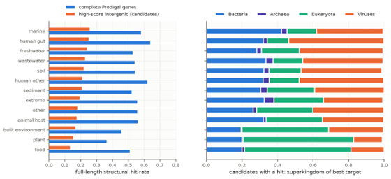
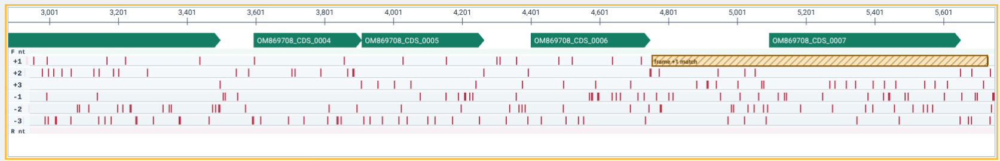

# Title

Joint sequence and structural entropy distinguish protein-coding genes
from spurious open reading frames in bacterial genomes and metagenomes.

# Authors

# 

# Abstract

Accurate identification of protein-encoding genes (PEGs) from all
potential open reading frames (ORFs) remains a fundamental challenge in
microbial genomics. Most ORFs do not encode functional proteins. Gene
callers use a variety of heuristics to identify candidate ORFs, but they
do not directly assess whether those ORFs encode biologically meaningful
proteins. Here, we introduce a complementary entropy-based framework
that integrates DNA entropy, amino acid sequence entropy, and predicted
structural entropy to distinguish bona fide protein-coding genes from
non-coding ORFs.

Using a curated set of bacterial genomes annotated in GenBank, we
calculated nucleotide, amino acid, and three-dimensional (3Di)
structural entropy for all ORFs, separating those annotated as
protein-coding genes from unannotated ORFs. We show that real proteins
occupy a distinct region of joint sequence--structure entropy space,
whereas non-coding ORFs exhibit characteristic signatures of low
information content or structural incoherence. We then apply this
framework to one million ORFs from the LOGAN dataset, which were
predicted by Prodigal and represent putative protein-coding genes from a
large-scale metagenomic resource.

Our results demonstrate that jointly considering sequence and structural
entropy robustly separates real proteins from non-coding ORFs and
provides a quantitative framework for assessing gene-calling confidence
in metagenomic assemblies. We propose integrating this approach into
metagenomic pipelines to improve functional annotation and reduce
false-positive gene predictions.

# Introduction

Accurate identification of protein-coding genes underpins nearly all
analyses in microbial genomics, from metabolic reconstruction to
evolutionary inference. Gene prediction tools such as Prodigal,
GeneMark, and Glimmer have achieved remarkable accuracy for complete
bacterial genomes; however, their performance degrades with short open
reading frames, and in fragmented assemblies and metagenomes, where
spurious open reading frames (ORFs) are abundant. These ORFs arise from
random nucleotide composition, short contigs, and assembly artifacts,
yet are often indistinguishable from true genes based solely on coding
statistics.

Traditional gene callers primarily rely on nucleotide-level statistical
features, such as codon usage, hexamer frequencies, and start/stop
signals. They often include a minimum gene length, below which
statistical models fail to discriminate PEGs from ORFs. The statistical
models do not directly assess whether a predicted ORF encodes a folded,
functional protein. As a result, datasets frequently contain large
numbers of predicted "proteins" that lack detectable homology,
structure, or biological function.

Evolutionary and biophysical principles highly constrain protein
sequences and structures. Functional proteins exhibit non-random amino
acid distributions and form stable three-dimensional structures, whereas
non-coding ORFs lack such constraints. Entropy provides a natural
quantitative framework to capture these differences \[1\]. Sequence
entropy measures the information content and compositional complexity of
nucleotide or amino acid sequences, while structural entropy captures
the diversity and coherence of predicted structural states.

Here, we introduce an entropy-based framework that jointly considers
nucleotide and amino acid sequence entropy and predicted structural
entropy derived from 3Di encodings. Using bacterial genomes annotated in
GenBank as a ground-truth dataset, we demonstrate that real proteins and
non-coding ORFs occupy distinct regions of entropy space. We then extend
this analysis to nine billion ORFs from the LOGAN dataset \[2\],
providing large-scale validation and demonstrating applicability to
metagenomic gene prediction.

# Methods

## Overview of the genome entropy framework

All analyses were performed using the *genome_entropy* software package
(https://github.com/linsalrob/genome_entropy). The pipeline accepts
nucleotide sequences (GenBank or FASTA), extracts ORFs, translates them
into amino acid sequences, predicts structural representations, and
computes entropy measures at multiple biological levels. The same
codebase was used to generate both the GenBank-derived and LOGAN
datasets.

## ORF extraction and classification

For GenBank genomes, we extracted ORFs directly from annotated records.
To discriminate real proteins and ORFs that are unlikely to encode
functional proteins, each ORF was labelled according to whether it
overlapped a curated protein-coding gene annotation (*in_genbank=True*)
or represented an unannotated ORF (*in_genbank=False*).

For the LOGAN dataset, ORFs were predicted using Prodigal and treated as
putative protein-coding genes, consistent with standard metagenomic
workflows.

DNA sequence entropy

For each ORF, Shannon entropy was computed over the nucleotide alphabet
{*A. C, G, T}*:

where (p~i~) is the observed frequency of the i^th^ nucleotide in the
sequence.

## Amino acid sequence entropy

For each ORF translated into an amino acid sequence, Shannon entropy was
computed over the amino acid alphabet:

where (p~i~) is the observed frequency of amino acid (i) in the
sequence.

This measure captures the compositional complexity of the sequences.
True proteins are expected to exhibit characteristic entropy ranges
reflecting evolutionary constraints, whereas non-coding ORFs often show
reduced entropy or pathological amino acid biases.

## Structural encoding and 3Di entropy

To assess structural information content, amino acid sequences were
converted into discrete 3Di representations using pretrained protein
structure models. The 3Di alphabet encodes local backbone conformations
and tertiary interaction patterns, providing a compact, sequence-like
representation of predicted structure.

Shannon entropy was then computed over the 3Di alphabet for each ORF:

where ( q~j~ ) is the frequency of the 3Di state ( j ) within the
sequence.

This measure reflects the diversity and coherence of predicted
structural states. Functional proteins tend to form structured,
repetitive, and modular architectures, whereas non-coding ORFs produce
structurally incoherent or low-complexity predictions.

## Joint entropy space and statistical analysis

Amino acid entropy and 3Di entropy were analysed jointly to assess their
combined discriminatory power. ORFs were visualised in two-dimensional
entropy space, and distributions were compared between annotated
proteins and unannotated ORFs.

All analyses were conducted using Python-based scientific libraries, and
figures were generated directly from the output of the *genome_entropy*
pipeline.

## Genome reannotation and ORF-level entropy analysis

We obtained complete bacteriophage genomes from the INPHARED database
and reannotated them using a combined workflow incorporating Pharokka,
Phold, and Phynteny. We used Pharokka to identify protein-coding genes
and generate an initial genome annotation, while Phold and Phynteny
improved functional annotation through protein-structure similarity and
conserved genomic-context information, respectively.

In parallel with the annotation workflow, all possible open reading
frames (ORFs) identified within each genome were analysed using the
genome entropy pipeline. For each ORF, we calculated sequence-derived
features from the nucleotide sequence, translated amino-acid sequence,
and predicted 3Di structural-alphabet sequence. These features included
nucleotide, protein, and 3Di entropy, together with ORF length, genomic
position, strand, reading frame, and the presence or absence of
canonical start and stop codons.

We used an XGBoost-based classification model to estimate the
probability that each ORF represented a genuine protein-coding gene. The
classifier was trained using ORFs corresponding to protein-encoding
genes in the reference annotations as positive examples and alternative,
unannotated ORFs as negative examples. The model therefore assigned each
ORF a probability between 0 and 1 representing its predicted likelihood
of encoding a protein. Higher values indicated stronger support for a
coding ORF.

## Examination of alternative overlapping ORFs in genome OM869708

Genome OM869708 was selected as a representative example in which the
genome entropy model identified a plausible protein-coding ORF that
differed from the ORF selected by the conventional annotation workflow.
Genome annotations and overlapping ORFs were visualised using
genbank_viewer. The region contained the annotated protein-encoding gene
CDS007, which corresponded to ORF7 in the genome entropy output. ORF7
overlapped an alternative reading frame designated ORF3.

The coding probabilities and entropy features of ORF7 and ORF3 were
compared. We then searched the translated protein sequences against the
NCBI non-redundant database using BLASTP and manually evaluated them.

## Analysis of LOGAN metagenomes

From the LOGAN v1.2 SRA metadata (38,072,291 runs)\[2\], we kept runs
meeting all of the following criteria: - librarysource = METAGENOMIC
(7,754,394 runs); - assay_type = WGS (1,122,461); - random-shotgun
library selection (RANDOM, RANDOM PCR or unspecified; 863,841); -
short-read platforms; - an NCBI "... metagenome" organism name,
excluding synthetic, mock and mixed-culture (761,663).
Human-*associated* microbiomes were retained. Librarysource excluded
human and isolate WGS.

Each run was assigned to one of 13 biomes from the organism name, with
BioSample host and isolation source as fallback; generic names with a
human host were mapped to human gut or other human. Assembly statistics
came from the LOGAN seqstats tables. We used the v1.1 statistics where
present, as the v1.2 table still carries v1.0 statistics for accessions
assembled before 2024, which disagreed with the published objects by up
to 30%.

Accessions were drawn with contig sums of 5--300 Mbp and N50 ≥ 150 bp.

### LOGAN analysis pipeline

Each accession's LOGAN contig object was downloaded, its byte count
checked against the S3 source and its zstd stream verified, and its
contig count and total length compared with seqstats. 81 runs could not
be found, and a single run did not agree with the recorded seqstats and
was discarded. Contigs ≥120 nt were retained. We ran MetaProdigal with
GFF output so that partial flags, start type and per-contig genetic code
are recorded. ORFs were enumerated with genome_entropy's own find_orfs
and translate_orfs (using genetic code 11). An ORF is labelled Prodigal+
when a Prodigal gene on the same contig and strand ends at the same
stop, the pair have the same codon phase, and the shorter ORF has≥90%
overlap and≥98% shared amino-acid identity. Prodigal writes M for
GTG/TTG initiators, so the first residue is aligned to the ORF's before
the identity test. We developed five Prodigal classes from the
largest-overlapping Prodigal gene, *antisense shadow ORF* (opposite
strand); *frameshift shadow* *ORF* (same strand, different frame);
*marginal overlap* (\<30 bp); *same-frame-unmatched* (almost all
genetic-code-4 Prodigal models reading through TGA); and *intergenic*
(no overlap).

ORF translations were encoded with modernprost-50M (revision 2d68d506)
at the package's default encoding size using Pawsey's MI250X nodes: 8
GCDs × 4 persistent encoder workers, at 215--220 k aa s⁻¹ per GCD. We
wrote the amino acids, 3Di, and 12-state strings to one row per ORF in
chunked zstd TSV (1 M ORFs per chunk), then re-read them in full with
per-column SHA-256 checks.

### Analysis and Statistics

Per-shard Parquet tables were generated to support large-scale analysis,
with each shard containing no more than 1,000 cache chunks,
corresponding to approximately one billion ORFs. These tables retained
each ORF's classification labels, genomic coordinates, truncation status
and derived features, while excluding amino-acid and structural-state
sequences to minimise storage requirements. The resulting tables
required approximately 16.5 GB per billion ORFs. As a validation, values
from the first shard were compared with the underlying per-ORF library
outputs for 2.7 million ORFs. Entropy measurements agreed to within 5 x
10^-5^ bits, and ORF classifications showed 100% concordance.

Single-feature discrimination was evaluated using stratified
distributions and ranking-based metrics. We generated histograms
separately by ORF class, truncation status, length bin, biome, and
processing tranche, using 0.01-bit bins for entropy measures and
logarithmically spaced bins for ORF length. For each feature, we
calculated the exact receiver-operating-characteristic area under the
curve (ROC AUC), with ties contributing one-half, and average precision
(AP), both overall and within nine ORF-length bins. To minimise
confounding by ORF length, we additionally calculated a
length-stratified AUC, defined as the probability that a randomly
selected positive and negative ORF drawn from the same length bin were
ordered correctly. Multivariable discrimination was assessed using a
class-stratified sample of 8.2 million complete ORFs drawn from 61
shards. Population weights were calculated as the inverse of each
class-specific sampling rate. We trained HistGradientBoostingClassifier
models on nested feature sets using five-fold cross-validation grouped
by SRA accession; we fitted the models without sample weights but
evaluated them using the population weights. We also applied models
trained on complete ORFs unchanged to contig-end fragments to assess
generalisation to truncated sequences.

Reading-frame specificity was investigated using a deterministic 1%
hash-based sample of complete Prodigal-positive genes, comprising 7.74
million genes from 77 shards. For each Prodigal-selected coding frame,
we identified the best-overlapping Prodigal-negative ORF in each of the
five alternative reading frames: the two alternative frames on the same
strand (+1 and +2) and the three frames on the opposite strand (a0--a2).
Cross-frame inheritance of each feature was quantified using Spearman
rank correlation between the selected coding frame and each alternative
frame across genes. Discriminatory ability was evaluated using tie-aware
top-(k) rates, asking how often the Prodigal-selected frame ranked among
the highest-scoring frames for each feature, with performance compared
against the corresponding chance expectation of (1/(k+1)).

# Results

## Real proteins and non-coding ORFs occupy distinct entropy regimes

Analysis of ORFs from several hundred bacterial genomes revealed a clear
separation between annotated protein-coding genes and unannotated ORFs
when considering amino acid entropy and 3Di entropy jointly.

Annotated proteins (in_genbank=True) clustered within a well-defined
region characterised by moderate to high amino acid entropy and
structured, non-random 3Di entropy values. In contrast, unannotated ORFs
(in_genbank=False) exhibited broader and often bimodal distributions,
including regions of abnormally low amino acid entropy, low structural
entropy, or discordant combinations of the two.

Importantly, neither amino acid entropy nor 3Di entropy alone was
sufficient to separate the two classes. The strongest discrimination
emerged from their combination, demonstrating that sequence and
structural information capture complementary biological constraints.

{width="7.268055555555556in"
height="4.699305555555555in"}

**Fig. 1.** Differentiation between protein-encoding ORFs (green) and
all other ORFs (blue).

## Structural entropy reveals non-coding ORFs with protein-like composition

A subset of unannotated ORFs exhibited amino acid entropy values
overlapping those of real proteins, suggesting superficially
protein-like composition. However, these ORFs showed markedly different
3Di entropy profiles, indicating structurally implausible or incoherent
predictions.

This observation highlights the value of incorporating structural
information: sequence-based metrics alone can misclassify chance ORFs
that mimic amino acid composition, whereas structural entropy reveals
their lack of foldable architecture.

## The six-frame ORF space of 50,000 assembled metagenomes

We analysed 50,009 shotgun metagenomes from LOGAN v1.2, comprising 4.90
Tbp of assembled contigs distributed across 13 environmental and
host-associated biomes. Enumeration of all stop-to-stop ORFs of at least
30 amino acids in all six reading frames yielded 89.99 billion ORFs,
representing 5.28 trillion translated amino acids. Every ORF was encoded
by ModernProst-50M into paired 3Di and 12-state structural-alphabet
sequences and compared with Prodigal calls generated independently from
the same contigs.

The six-frame ORF space was dominated by alternative translations of
regions containing Prodigal-predicted genes. Across all 89.99 billion
ORFs, 47.6% were antisense shadows of Prodigal genes and a further 27.0%
were same-strand, alternative-frame shadows. Only 8.7% were intergenic,
whereas 15.5% matched a Prodigal call. Thus, nearly three quarters of
all ORFs were alternative translations overlapping a conventional gene
call rather than independent intergenic ORFs. Assembly fragmentation was
also pervasive: approximately 59% of ORFs were open at a contig
boundary, including 18.1% at the 5′ end and 41.2% at the 3′ end.

Most Prodigal-matched ORFs were themselves fragments. Complete Prodigal
genes accounted for only 1.0% of all ORFs, corresponding to
approximately 881 million ORFs, whereas partial Prodigal genes accounted
for a further 14.5% of all ORFs. The LOGAN metagenomes therefore provide
an unusually challenging gene-recognition problem in which the
overwhelming majority of candidate translations are either alternative
reading frames of known coding regions or fragments created by contig
boundaries.

**Table 2. Classification of ORFs in the analysed LOGAN metagenomes.**

  ------------------------------------------------------------------------
  Class                    Fraction of all   Complete   Open 5′  Open 3′
                           ORFs                                  
  ------------------------ ----------------- ---------- -------- ---------
  Prodigal+, complete gene 1.02%             620 M      ---      ---

  Prodigal+, partial gene  14.43%            5.4 M      1.34 B   7.46 B

  Antisense shadow         47.56%            13.39 B    5.42 B   10.20 B

  Frameshift shadow        26.81%            8.16 B     2.84 B   5.36 B

  Intergenic               8.91%             2.76 B     1.19 B   1.49 B

  Marginal overlap         1.20%             478 M      129 M    124 M

  Same frame, unmatched    0.07%             22 M       20 M     ---
  ------------------------------------------------------------------------

### The structural-alphabet entropy distinguishes coding ORFs from the alternative ORF spaceThe structural-alphabet entropy distinguishes coding ORFs from the alternative ORF space

ORF length was strongly associated with whether an ORF was selected by
Prodigal. This is expected because Prodigal explicitly imposes minimum
gene-length constraints and favours longer uninterrupted coding regions,
while our six-frame enumeration includes all ORFs of at least 30 amino
acids. A pooled comparison of Prodigal-positive and Prodigal-negative
ORFs would therefore partly recover a property of Prodigal's decision
rule. To remove this tautological length effect, we evaluated all
sequence- and structure-derived features within 50-amino-acid length
strata (the 30--49 aa interval was retained separately at the lower
boundary).

Within these length-controlled comparisons, the predicted structural
alphabets strongly distinguished complete Prodigal-positive ORFs from
complete Prodigal-negative ORFs (Figure 2). Thus, the structural signal
strengthened with increasing ORF length even though length itself was
held approximately constant within each comparison.

Shadow ORFs provided an especially stringent comparison because they
overlap called genes and are therefore generated from the same
coding-rich genomic regions. Within matched length strata, antisense and
frameshift shadows remained systematically lower in 3Di and 12-state
entropy than Prodigal-selected ORFs. This indicates that high
structural-alphabet entropy is associated with the selected translation
itself rather than simply with the presence of coding DNA at the locus.

{width="5.833333333333333in"
height="2.4881069553805775in"}

*Figure 2. Feature distributions for complete Prodigal-positive and
Prodigal-negative ORFs within fixed ORF-length ranges. Complete coding
ORFs retain substantially higher predicted structural-alphabet entropy
than alternative ORFs after controlling for length.*

To explore whether the structural-alphabet features remained informative
when several sequence-derived features were considered together, we
evaluated gradient-boosted classifiers by five-fold cross-validation
grouped by SRA accession, but interpretation focused on performance
within ORF-length strata rather than pooled performance across the
entire length distribution.

Within the 100--149 aa and 150--199 aa intervals, adding 3Di entropy,
12-state entropy and 3Di--12-state mutual information consistently
improved discrimination of Prodigal-positive ORFs from Prodigal-negative
ORFs over amino-acid entropy alone. The gain was particularly pronounced
against antisense and frameshift shadows, where ORF length is
intrinsically less informative because the alternative ORFs overlap bona
fide coding regions and have similar length distributions. Across these
comparisons, models incorporating the structural features separated the
Prodigal-selected frame substantially better than models using
sequence-composition features alone.

The same conclusion was evident from the out-of-fold model scores
evaluated within individual length bins. For ORFs of 100--149 aa, models
incorporating 3Di features reached approximately 0.90 AUC against all
Prodigal-negative ORFs; at 150--199 aa this increased to approximately
0.96. In this LOGAN dataset, the short-ORF regime remained the principal
limitation: below approximately 75 aa, all features showed much weaker
discrimination.

{width="5.833333333333333in"
height="2.289425853018373in"}

*Figure 3. Performance of cross-validated models evaluated within
ORF-length bins. Structural-alphabet features retain strong
discriminatory power where length itself provides little or no
information.*

### Structural features also identify coding fragments at contig boundaries

A defining feature of the LOGAN metagenome assemblies is the large
number of ORFs truncated by contig boundaries. We therefore tested the
hypothesis that a classifier trained exclusively on complete ORFs could
recognise partial Prodigal genes among truncated alternative ORFs
without retraining. Structural features substantially improved
classification in both directions of truncation.

The complete-ORF model retained substantial discriminatory power when
applied unchanged to truncated ORFs. For 5′-open fragments, the full
feature set achieved an AUC of 0.791 and average precision of 0.559; for
3′-open fragments, the corresponding values were 0.854 and 0.751. Thus,
the coding signal captured by the predicted structural alphabets
generalises from complete genes to protein fragments despite the absence
of one of the normal ORF boundaries.

### Structural entropy is specific to the selected reading frame

The large separation between coding ORFs and shadow ORFs raised an
important mechanistic question: does high structural entropy simply
arise from properties of the underlying DNA that are inherited by
multiple reading frames, or is it specific to the biologically selected
translation? We addressed this directly in a six-frame analysis of 8.82
million complete Prodigal genes. For each gene, we identified the
best-overlapping Prodigal-negative ORF in each of the five alternative
reading frames. A total of 5,722,417 loci contained suitable ORFs in all
five alternative frames.

ORF length and amino-acid entropy showed clear cross-frame inheritance.
Across the five alternative reading frames, Spearman correlations with
the Prodigal-selected frame ranged from 0.33 to 0.45 for ORF length and
from 0.29 to 0.36 for amino-acid entropy. This is consistent with the
different translations sharing the same underlying nucleotide
composition and local stop-codon environment. In contrast, neither 3Di
nor 12-state entropy was correlated between frames, supporting our
prediction that high structural entropy in one reading frame does not
necessarily produce high structural entropy in an alternative
translation of the same DNA.

{width="5.833333333333333in"
height="3.1737587489063865in"}

*Figure 6. Cross-frame inheritance of ORF features. Length and
amino-acid entropy are partially correlated between translations of the
same genomic locus, whereas 3Di and 12-state entropy and 3Di--12-state
mutual information are effectively frame-specific.*

Among genes for which all five alternative ORFs were present, 3Di
entropy ranked the Prodigal frame highest in 92.5% of loci. Thus, the
structural-alphabet measures do not merely reflect sequence properties
inherited across frames: they preferentially assign high information
content to the translation selected independently by Prodigal.

The distributions of the within-locus contrasts further showed that the
Prodigal-selected frame was usually substantially higher than the median
of its alternatives. The improvement was strongest for ORFs longer than
approximately 75--100 aa; shorter ORFs (\<75 aa) remained difficult for
all features.

{width="5.833333333333333in"
height="1.3501574803149605in"}

*Figure 8. Within-locus difference between the Prodigal-selected frame
and the median of the five alternative reading frames.*

### A large population of Prodigal-negative ORFs remains for candidate gene discovery**3.6 A large population of Prodigal-negative ORFs remains for candidate gene discovery**

The discrimination analyses also define a biologically interesting
discordant population: ORFs not called by Prodigal but assigned high
coding probability by genome entropy. Most Prodigal-negative ORFs are
readily explained as short intergenic ORFs or alternative-frame shadows
of called genes, but the combined LOGAN dataset contains sufficient
diversity and scale to identify the much smaller subset of complete,
non-shadow ORFs with gene-like structural-alphabet signatures.

These discordant ORFs are particularly useful because Prodigal and
genome entropy use fundamentally different information. Prodigal models
nucleotide-level coding statistics, translation initiation and gene
architecture, whereas genome entropy evaluates the information content
of the resulting amino-acid and predicted structural-alphabet sequences.
High-scoring Prodigal-negative ORFs therefore provide candidates for
genes that are missed by a conventional sequence-based caller but
supported independently by protein-level features. These candidates can
subsequently be tested by sequence homology, Foldseek
structural-alphabet searches, and comparative genomic conservation.

### Biome specific analyses

The final complete-ORF model, incorporating ORF length and all four
entropy-derived features, was applied to all 49.95 million intergenic
Prodigal-negative ORFs of at least 100 aa, together with 4.58 million
sampled controls. Candidate thresholds were defined from out-of-fold
model scores corresponding to specified population-weighted precision
among complete Prodigal-positive and Prodigal-negative ORFs (Table S12).
These thresholds therefore provide a relative ranking of intergenic ORFs
rather than an estimate of their absolute precision. At the 0.90
threshold, high-scoring candidates occurred in nearly every accession
and at broadly similar frequencies across biomes, ranging from 5.5% of
scanned ORFs in soil metagenomes to 8.7% in human gut metagenomes (Table
S14). The proportion above threshold increased with ORF length, from
approximately 7% at 100--149 aa to 20% at 200--299 aa.

To test whether these high-scoring ORFs showed independent evidence of
protein-coding potential, we selected 20,000 complete or 5′-open
candidates above the 0.90 threshold and compared them with three
length-matched control groups of 20,000 ORFs each: low-scoring
intergenic ORFs, antisense shadows and complete Prodigal genes. A fourth
control consisted of the same candidate proteins with their 3Di strings
shuffled, preserving amino-acid sequence and 3Di composition while
destroying structural-state order. All groups were searched with
Foldseek against PDB100, AFDB/Swiss-Prot, CATH50 and BFVD, using both
3Di+AA and amino-acid-only searches at E ≤ 10⁻³. We considered a hit
convincing only when both query and target coverage were at least 0.8,
because partial alignments can also arise from high-entropy shadow ORFs.
By this criterion, 19.3% of candidates had a full-length structural
homologue, compared with 0.03% of low-scoring intergenic ORFs, 0.13% of
antisense shadows and none of the shuffled-3Di controls; the
positive-control Prodigal genes reached 56.1% (Table 7; Figure 9). Thus,
high-scoring candidates showed full-length structural support at several
hundred times the rate of matched low-scoring intergenic ORFs, and the
shuffled control indicates that this signal depends on the order of
predicted structural states rather than their composition alone.

**Table 7. Foldseek evidence by arm, four databases (Table S16).**

  -------------- -------------- -------------- -------------- --------------
  Arm            Full-length,   Full-length,   Any hit,       Any hit,
                 structure      sequence       structure      sequence

  Complete       56.1%          26.6%          64.9%          67.8%
  Prodigal genes                                              

  High-score     **19.3%**      2.9%           37.7%          38.4%
  intergenic                                                  
  (candidates)                                                

  Candidates,    0.0%           ---            0.04%          ---
  shuffled 3Di                                                

  Low-score      0.03%          0.08%          0.14%          9.7%
  intergenic                                                  

  Antisense      0.13%          0.04%          0.44%          9.1%
  shadows                                                     
  -------------- -------------- -------------- -------------- --------------

Most of the similarity between candidate sequences and databases only
derives from the structure. 16.6% of candidates had a full-length
structural hit without a full-length sequence hit, and only 2.7% had
both (Figure 11). We previously showed that bacterial proteins often
only exhibit structural similarity \[Baktfold paper\], and here we
extend that observation to metagenomic sequences. Weighted by the
population's length distribution, about 16% of the 3.07 million complete
and 5′-open candidates above the 0.90 threshold, roughly 0.5 million
ORFs, would have a full-length structural homologue in these four
databases and not be identified as a gene by Prodigal.

### Many candidates match eukaryotic or viral proteins. 

We assigned each best full-length hit to the superkingdom of its target
(Table S19). Among candidates with a hit, 29.8% of best targets were
eukaryotic, against 7.4% for Prodigal genes; 29.0% were bacterial
against 54.0%; and 38.4% viral against 35.1%. The viral share is similar
in both arms and largely reflects BFVD's size; the eukaryotic excess is
not. It is strongest in food (60% of candidate hits eukaryotic), plant
(62%) and built-environment (49%) metagenomes. These biomes also have
the lowest candidate hit rates (13--17%), and the lowest hit rates for
Prodigal genes (36--51%) (Table S20; Figure 12). In human gut,
freshwater and marine metagenomes, candidates hit at 24--26% and their
best targets are mostly bacterial or viral (12--21% eukaryotic). A
substantial part of the missed-gene population is therefore probably
eukaryotic coding sequence (exons and intronless genes) that Prodigal's
prokaryotic model does not call. The rest look like prokaryotic and
phage genes that it misses.

{width="5.833333333333333in"
height="2.0520833333333335in"}

*Figure 8. Foldseek evidence by query (20,000 length-matched queries
each; PDB100, AFDB/Swiss-Prot, CATH50, BFVD). Solid bars: 3Di+AA
structural search; hatched bars: amino-acid-only search. Left: hits with
full-length mutual coverage; right: any hit at E ≤ 10⁻³.*

{width="5.833333333333333in"
height="2.2291666666666665in"}

*Figure 10. Full-length evidence classes over all four databases.*

{width="5.833333333333333in"
height="2.65625in"}

*Figure 11. Left: full-length structural hit rate by biome for
candidates and complete Prodigal genes. Right: superkingdom of the best
target for candidates with a hit.*

### LOGAN Computational scale**3.7 Computational scale**

Processing the combined dataset required encoding 5.28 trillion amino
acids from 89.99 billion ORFs and generated approximately 5.95 TB of
compressed AA/3Di/12-state cache. ModernProst-50M sustained
approximately 215--220 thousand amino acids s⁻¹ per MI250X GCD. Encoding
the 5.28 trillion amino acids therefore required approximately 5.7 ×
10²⁰ floating-point operations, consuming approximately 1.06 million GPU
service units, and 264,000 CPU service units were billed. The observed
ModernProst encoding cost was approximately 176,000 GPU service units
per Tbp of assembled metagenomic sequence.

The resulting cached representation allows downstream entropy,
mutual-information, gene-calling and structural-homology analyses to be
repeated without rerunning ModernProst. At the scale of 50,009
metagenomes, the biological analyses are therefore limited primarily by
statistical design and interpretation rather than by the size of the
available ORF population.

## Genome entropy identifies an alternative replication-associated ORF in OM869708.

The genome entropy analysis identified a likely annotation error in
bacteriophage genome OM869708. In the Pharokka, Phold, and Phynteny
annotation, CDS007 was assigned to ORF7. However, the XGBoost-based
classifier provided relatively weak support for ORF7 as a genuine
protein-coding sequence, assigning it a coding probability of 0.27. ORF7
also had low 3Di entropy, indicating limited complexity in its predicted
structural-alphabet sequence and providing additional evidence that it
might not encode a conventional, structured protein.

An alternative ORF, ORF3, overlapped ORF7 but occupied a different
reading frame. In contrast to ORF7, ORF3 received a coding probability
of 0.91, providing strong model support for ORF3 as the more likely
protein-coding gene. Visualisation of the locus using genbank_viewer
clearly showed the mutually incompatible, overlapping gene models
represented by ORF7 and ORF3 (Figure 1).

The database-search results provided independent functional support for
the genome entropy prediction. The protein encoded by ORF7 did not
produce detectable matches to proteins in the searched database. By
contrast, the protein encoded by ORF3 produced multiple matches to viral
replication initiator proteins. Its highest-scoring match was to a
replication initiator protein from *Dipodfec virus* RodF1 38. The
recovery of several concordant replication-associated matches indicates
that ORF3 encodes a conserved viral protein rather than a spurious
translation product.

Together, these observations strongly support ORF3 as the correct
protein-coding gene at this locus. ORF3 had a substantially higher
predicted coding probability than the annotated ORF, encoded a protein
with identifiable homologues, and was consistently associated with a
biologically plausible viral replication function. Conversely, the
annotated ORF7 had low model support, low 3Di entropy, and no detectable
database matches.

The reason that ORF3 was not selected by the Pharokka, Phold, and
Phynteny workflow is not immediately apparent. Because Phold and
Phynteny primarily assign functions to proteins supplied by the upstream
annotation and gene-calling stages, one likely explanation is that the
initial gene caller selected ORF7 and did not report ORF3 as a candidate
protein-encoding gene. Downstream annotation methods would consequently
have had no opportunity to evaluate the ORF3 protein. This example
therefore illustrates that improved functional annotation cannot fully
compensate for an incorrect initial gene model.

More broadly, the OM869708 locus demonstrates how genome entropy can
complement conventional phage annotation pipelines. Rather than
considering only the ORFs selected by a single gene caller, the approach
evaluates competing ORFs across overlapping reading frames and assigns
each an independent probability of being protein coding. In this case,
the model identified an alternative ORF with both stronger
sequence-derived support and clear functional homology. Genome entropy
can therefore reveal plausible genes missed by conventional gene callers
and help distinguish the most likely coding frame in regions containing
conflicting or overlapping ORFs.

{width="7.260416666666667in"
height="1.1770833333333333in"}**Fig. 1. Genome of OM869708.** The
visible range is 2880..5748. The orange box highlights the
sequence-search match at 4753..5727. The green CDS arrows indicate the
Pharokka/Phold annotations. Vertical bars mark the stop codons in each
of six reading frames.

# Discussion

Our results demonstrate that protein-coding genes exhibit characteristic
patterns of both sequence and structural entropy that distinguish them
from spurious ORFs. While gene prediction algorithms are highly
effective, they do not directly assess whether a predicted ORF encodes a
foldable, functional protein. Entropy-based analysis fills this gap by
explicitly evaluating biological information content.

The strong agreement between GenBank-annotated proteins and the majority
of LOGAN ORFs supports the validity of large-scale metagenomic gene
prediction and highlights a principled approach to identifying
questionable predictions. Importantly, this method does not rely on
homology or functional annotation, making it particularly well suited to
novel proteins and deeply sampled metagenomes.

We propose integrating joint sequence--structure entropy into
metagenomic pipelines as a post-processing step, complementing existing
gene callers and improving annotation quality. More broadly, this
framework provides a quantitative lens for studying the boundary between
coding and non-coding sequence space in microbial genomes.

# Data availability

All code used in this study is available at the *genome_entropy* GitHub
repository. Processed entropy datasets and analysis notebooks are
available upon request.

1\. **Akhter S, Bailey BA, Salamon P, Aziz RK, Edwards RA**. Applying
Shannon's information theory to bacterial and phage genomes and
metagenomes. *Sci Rep* 2013;3:1033.

2\. **Chikhi R, Lemane T, Loll-Krippleber R, Montoliu-Nerin M, Raffestin
B, *et al.*** Logan: Planetary-scale genome assembly surveys life's
diversity. *bioRxivorg* 2025;2024.07.30.605881.
